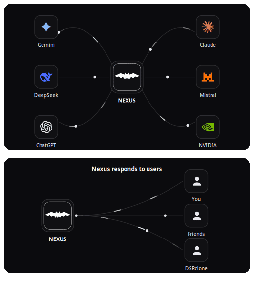

# Nexus

Chat with every AI, from one Nexus — **23 provider lanes, one login, one shared memory.** Runs locally, or as a hosted instance for you and your friends.

**Live:** https://nexusos.dpdns.org — a private instance. Anyone can see the home page; accounts are created by the admin for friends (no public sign-up). For your own instance with your own keys, follow the setup below.


## 🧊 3D Architecture

[](nexus-beam.svg)

You sign in through Caddy over HTTPS and land on the one Nexus app. The app holds the chat with its shared memory, your encrypted vault and your integrations, calls the AI providers, keeps an encrypted backup on GitHub, and serves the /v1 API that powers DSRclone's copilot.

**Interactive:** open [`docs/3d/index.html`](docs/3d/index.html) in a browser — drag to orbit, scroll to zoom.

## What it does

- **One login, 23 lanes** — Gemini, ChatGPT-class and Claude-class models, Groq, OpenRouter free models, NVIDIA, Mistral, Cohere and more. Pick a lane, or let Auto route (Quality first / Save tokens).
- **One shared memory** — every model reads the same conversation. Switch providers mid-chat and the next AI continues where the last one stopped.
- **Chat modes** — Text, Code, Web search, Image, Voice, Video, Agentic, and Team.
- **Honest failover** — if a lane is down or rate-limited, Nexus tries the next one and shows a trace of what was tried.
- **Your own keys** — paste your provider API keys, or sign in with ChatGPT, Claude, or Gemini. Your keys live in your own encrypted vault.
- **A real API** — an OpenAI-compatible `/v1` endpoint supplies other projects, e.g. DSRclone's AI copilot.

## Setup

**Prerequisite:** Install Node.js (includes npm).

```bash
npm install -g github:xorudra/Nexus-Local
```

Then type **`nexuslocal`** from any directory. It starts the engine + dashboard and opens **http://127.0.0.1:8080** in your browser.

## Security

Provider keys are stored AES-256-GCM encrypted (PBKDF2 600,000 iterations) and decrypted only in memory after an admin login. Friends' chats and key vaults are encrypted under their own passwords — the admin cannot read them. Independently audited (25 rounds, 292 findings, 285 fixed, 0 surviving).
