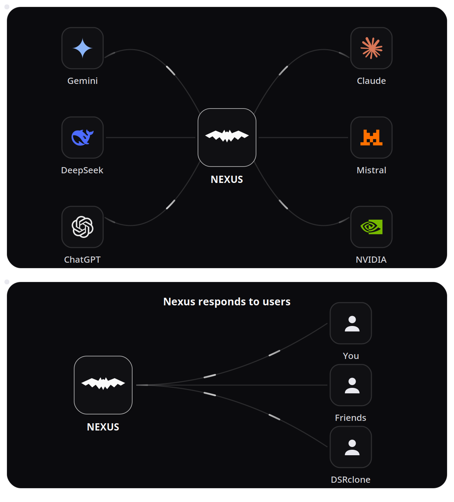

# Nexus

Chat with every AI, from one Nexus — **23 provider lanes, one login, one shared memory.** Runs locally, or as a hosted instance for you and your friends.

**Live:** https://nexusos.dpdns.org — a private instance. Anyone can see the home page; accounts are created by the admin for friends (no public sign-up). For your own instance with your own keys, follow the setup below.

## 🧊 3D Architecture

[](nexus-beam.svg)

You sign in through Caddy over HTTPS and land on the one Nexus app. The app holds the chat with its shared memory, your encrypted vault and your integrations, calls the AI providers, keeps an encrypted backup on GitHub, and serves the /v1 API that powers DSRclone's copilot.

**Interactive:** open [`docs/3d/index.html`](docs/3d/index.html) in a browser — drag to orbit, scroll to zoom.

### State and persistence

| Data | Where it lives | Notes |
| --- | --- | --- |
| Provider keys | `keys.enc` | AES-256-GCM, PBKDF2 (600,000 iterations). Never committed. Decrypted into memory only after the admin logs in. |
| Settings | `app/settings.json` and `app/settings.enc` | The plaintext working copy stays off git. The encrypted mirror is what syncs. |
| Friend accounts & access | `app/users.enc`, `app/access.enc` (plaintext `app/access.json` stays off git) | Each friend's vault and saved chats are encrypted with that friend's own password. The encrypted blobs are what sync to GitHub. |
| Usage log | `app/usage.jsonl` | Plain file on the server's disk. Not part of the encrypted sync, so it exists only on the machine that wrote it. |
| Audit log | `app/audit.jsonl` | Plain file, git-ignored. Same as the usage log. |
| Sessions | Memory | Cleared on every restart. |

## What it does

- **One login, 23 lanes** — Gemini, ChatGPT-class and Claude-class models, Groq, OpenRouter free models, NVIDIA, Mistral, Cohere and more, all behind a single account. Pick a lane yourself, or let Auto route (Quality first / Save tokens).
- **One shared memory** — every model reads the same conversation. Switch providers mid-chat and the next AI continues where the previous one stopped, with a handover note. Long chats compress older turns instead of dropping them.
- **Chat modes** — Text, Code, Web search, Image, Voice, Video, **Agentic** (one AI with tools: web search, page fetching, calculator, working step by step), and **Team** (four AIs in a line — Planner → Researcher → Analyst → Finisher — each stage can run on a different provider, and the Finisher's answer is the reply).
- **Honest failover** — if the lane you picked is down, rate-limited, or its model was retired upstream, Nexus tries the next lane and shows a trace of what was tried. A hand-picked lane that can't deliver says so — it never silently substitutes a different model in single-lane modes.
- **Connect your own AI accounts** — paste your own provider API keys, or sign in with your ChatGPT, Claude, or Gemini account (OAuth, the same flows their own CLI tools use). Your keys live in your own encrypted vault; chat prefers them when present.
- **Workspace integrations** — connect Gmail, Google Calendar/Meet, Zoom, Linear, Notion, Trello, Jira, and Mailchimp, verified live on save.
- **Friends, properly private** — friend accounts get everything above. A friend's saved chats and key vault are encrypted with that friend's own login password: the admin cannot read them.
- **A real API** — an OpenAI-compatible `/v1` endpoint (below) supplies other projects, e.g. DSRclone's AI copilot runs on Nexus.

## Setup

**Prerequisite:** Install Node.js (includes npm).

On Windows, open PowerShell or CMD and run:
```bash
winget install OpenJS.NodeJS
```
Or download from [nodejs.org](https://nodejs.org/).

Then:
```bash
npm install -g github:xorudra/Nexus-Local
```

Then type **`nexuslocal`** from any directory. That's it.

Auto-installs dependencies and launches everything. No admin rights needed.

## First Run

Type `nexuslocal`. It starts the engine + dashboard and opens **http://127.0.0.1:8080** in your browser.

The install ships with an encrypted key vault — log in with the master password and the providers are ready. That vault's only protection is the password itself; read the Security section below before reusing this setup.

To use your own keys instead, delete `keys.enc` from the install folder and use the **Quick Import** box on the setup page: paste all keys at once as `name: key` (one per line), click Fill Fields Below, set your password, done.

## Pages

- **Home** (`/`) — public landing page
- **Chat** (`/dashboard`) — composer with provider/model pickers, 10 modes, image attachments, saved chats, per-reply trace
- **Connections** (`/connections`) — every provider lane with live key status and usage
- **Integrations** (`/integrations`) — AI account connections (API keys + ChatGPT/Claude/Gemini sign-ins) and workspace tools (Gmail, Calendar, Zoom, Linear, Notion, Trello, Jira, Mailchimp)
- **My Keys** (`/mykeys`, friends) — your own encrypted key vault
- **API Access** (`/api-access`, admin only) — the external `/v1` API: named service keys (create, disable/enable, rotate, delete), supply-lane readiness, live self-test
- **Update Keys** (`/settings`, admin only) — the shared provider vault (shows last 4 chars, blank = keep current)

## External API (`/v1`)

Nexus can supply other projects (e.g. DSRclone's AI copilot) through an
OpenAI-compatible endpoint:

- `GET /v1/models` — `nexus-auto`, per-lane `lane/model` ids, and live lane catalogs
- `POST /v1/chat/completions` — standard OpenAI request/response shape

Access is key-based: named service keys are created and managed on the
**API Access** page (stored encrypted, mirrored like the other console
secrets). Clients send a key as `Authorization: Bearer <key>`; a disabled
key stops working immediately, and rotating a key kills the old secret on
the spot. While no keys are stored, the `NEXUS_V1_API_KEY` environment
variable works as a fallback; with no keys and no variable, the routes
answer 404. The API Access page shows the admin the full keys; everyone
else only ever sees the last 4 characters.

Ask for model `nexus-auto` and Nexus tries its supply lanes in order until
one answers, honouring the same circuit breaker as dashboard chat; usage
is logged as `v1:<lane>`. While the provider vault is locked (no admin
login since the last restart) only keyless lanes answer — the same rule
dashboard chat follows before unlock.

## Uninstall

```bash
npm uninstall -g nexuslocal
```

## Structure

```
├── README.md
├── package.json  ← `npm install -g` entry (bin: nexuslocal)
├── bin/          ← nexuslocal CLI launcher
├── app/          ← dashboard + engine code
├── tests/        ← 472-test suite (python3 -m unittest discover -s tests)
└── deploy/       ← deployment notes/config (live instance: Oracle Cloud)
```

## Providers (23 lanes)

**18 direct** — Google, Groq, OpenRouter, NVIDIA, Mistral, Cohere, HuggingFace, Cloudflare, Zhipu, OpenAI, Anthropic, Pollinations, Kilo, OVH, AI Horde, plus the account sign-in lanes Codex (ChatGPT), Claude OAuth, and Gemini CLI — and **5 relay** lanes (OpenRouter, Gemini, Groq, NVIDIA, Pollinations) served through a local relay.

Direct chat lanes ride the built-in FreeLLMAPI gateway (127.0.0.1:3001) — it's the infrastructure, not a provider itself.

Keyless providers (Pollinations, AI Horde, Kilo, OVH) work with no setup. Everything else runs on free/free-tier accounts — no lane can charge money.

## Security

Nexus runs in two shapes, and this section describes both honestly: locally
via the CLI above (bound to your machine), and as a hosted instance — the
live site linked at the top is a real multi-user deployment on Oracle
Cloud, reached over HTTPS, where the owner and invited friends sign in.
The hosted instance is not localhost-only, and AI requests always leave
the server for the provider you picked.

- Provider keys are stored AES-256-GCM encrypted (PBKDF2 600,000
  iterations) and decrypted only in memory after an admin login. After a
  restart the vault stays locked — keyless providers only — until then.
- An encrypted keys file ships in this repository. Encryption is the only
  barrier on that file: anyone can download it and attack it offline,
  where no lockout applies, so the master password's strength is what
  protects it. Pick a long one.
- The admin can enable TOTP two-factor sign-in. Friend accounts use
  PBKDF2-HMAC-SHA256 password hashes. Friends' saved chats and personal
  key vaults are encrypted under their own passwords — the admin cannot
  read them.
- Friend data, console settings, and usage/audit history are mirrored
  back to GitHub as encrypted files so they survive the host's
  ephemeral disk. The mirrors are ciphertext only.
- **Independently audited:** Nexus went through a 25-round security
  audit program (map → hunt per attack surface → independent
  verification of every candidate finding). Final ledger: 292 confirmed
  findings, 285 fixed, 6 accepted residuals, 0 surviving — closed with
  the owner's signed sign-off on 2026-10-19.
